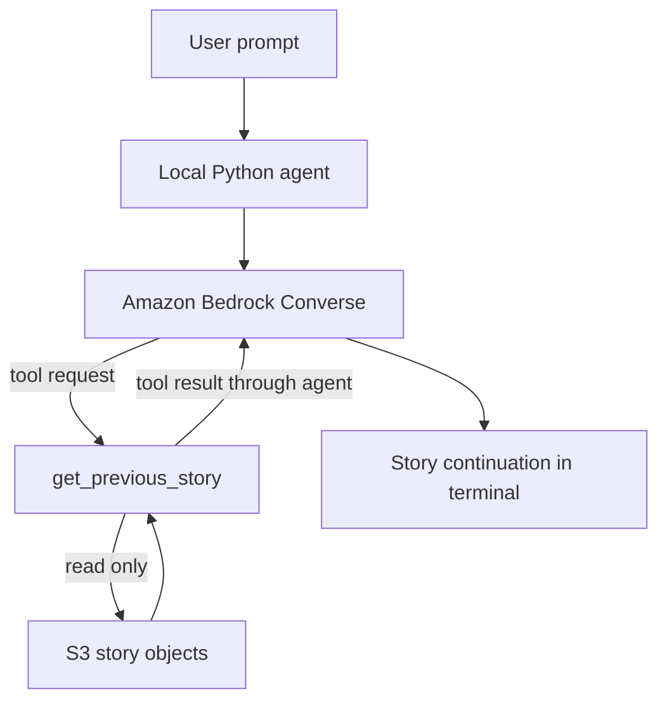

# Bousbi Remembers

A local Python storytelling agent that uses Amazon Bedrock Converse and one read-only tool to retrieve an earlier chapter from S3. The example contrasts an agent without memory access with one that can continue a saved story.

**Status:** Implementation and offline protocol tests are included. Live AWS execution and deployment have not been verified.

## Architecture

## Start here

Install dependencies with `pip install -r requirements.txt`. Run offline checks with `python -m unittest discover -s tests -v`. Live use additionally requires temporary AWS credentials, `BEDROCK_MODEL_ID` and, for retrieval, `STORY_BUCKET`. See [agent.py](agent.py) and [runtime permissions](docs/runtime-policy.json).

[Previous README and detailed reference](https://github.com/mtzanida/bousbi-remembers/blob/83535528146532d57d4d4aa45d4a9d1f1b8dadd1/README.md) are retained in Git history. They may describe older assumptions or unmerged plans; the scope above reflects this branch.
